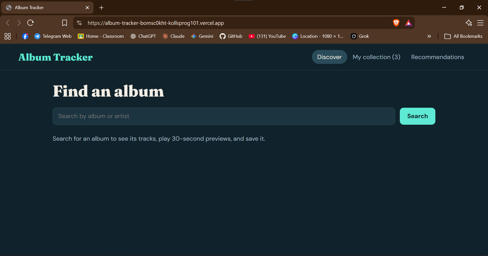
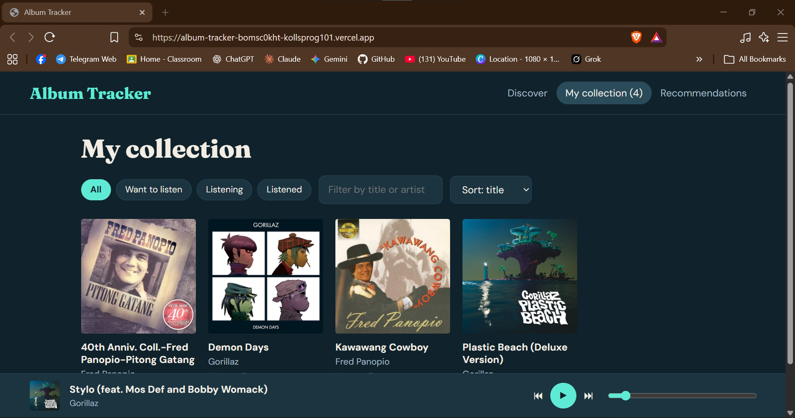
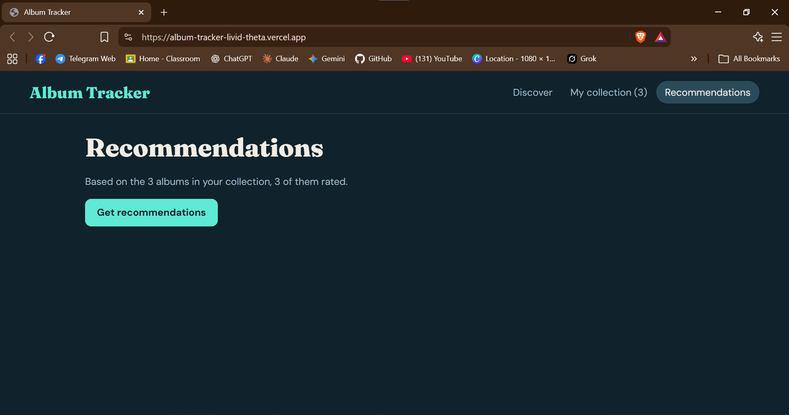

# Album Tracker

A React web app for searching music albums, previewing tracks, and keeping a personal listening log with statuses, ratings, and notes. It offers full-album playback through Deezer's embeddable player and LLM-powered recommendations based on the user's saved albums and ratings.

**Live link: https://album-tracker-bomsc0kht-kollsprog101.vercel.app/
**Screenshot: 
              
              


## Features
- Search albums and artists (iTunes Search API)
- Album page with track list, 30-second previews, and Spotify / YouTube / Apple Music links
- Mini player that keeps playing while you browse
- Collection with status, 1-5 star rating, notes, filter, and sort (saved in localStorage)
- Optional full album playback via Deezer
- Recommendations using Google Gemini

## Tech stack
React, Vite, Context API, iTunes API, Deezer, Gemini, Vercel serverless functions

## Run locally
```bash
git clone https://github.com/Kollsprog101/album-tracker.git
cd album-tracker
npm install
# create .env.local with: GEMINI_API_KEY=your-key
npm run dev
```

## Limitations
- Previews are 30 seconds (all the iTunes API provides)
- The collection is saved only in your browser
- Deezer needs a login (and a plan) for full tracks

## Privacy
The recommendations feature sends your saved albums' titles, artists, ratings, and statuses to Google's Gemini API. Your notes are not sent.

## Disclaimer
Learning project, not affiliated with Apple, Spotify, Deezer, or Google. Music data, artwork, and audio belong to their owners.
